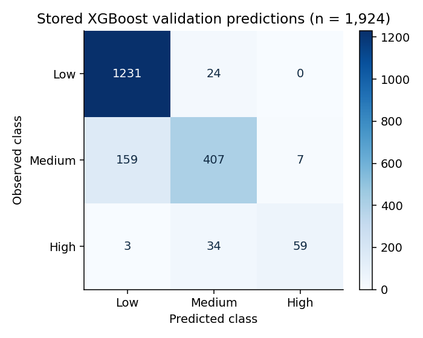
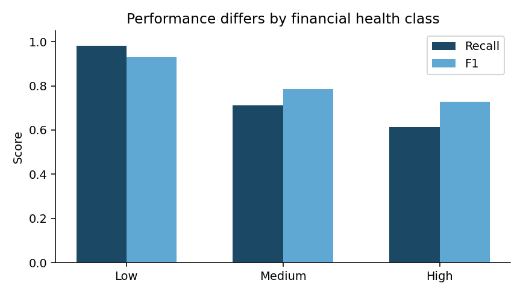
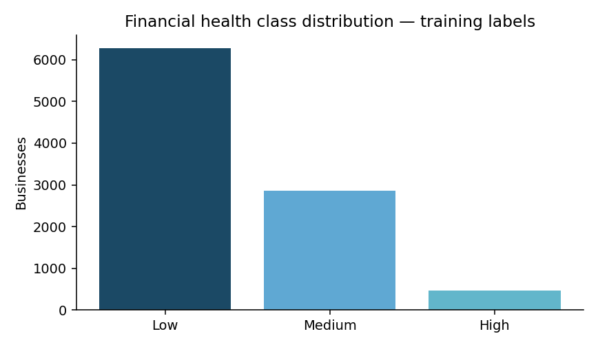

# SME Financial Health — R modelling and prediction API

**Predicting Low, Medium or High financial health for small businesses in Southern Africa.**

An R portfolio project by **Yader Alexander Ramírez Bonilla**, based on the [data.org Financial Health Prediction Challenge on Zindi](https://zindi.world/competitions/dataorg-financial-health-prediction-challenge). It combines exploratory analysis, domain-inspired feature engineering, multinomial regression, neural networks, XGBoost experiments and a Plumber inference API.

## Verified saved results

The supplied workspace contains the validation probabilities for the no-ID XGBoost experiment. Rescoring these saved predictions gives:

| Metric | Internal validation |
|---|---:|
| Accuracy | 0.8820 |
| Macro F1 | 0.8141 |
| Multiclass log loss | 0.2999 |
| Training / validation | 7,694 / 1,924 |

**API verification:** the exported model reproduces all 2,405 saved submission labels; the recovered validation engine agrees with the stored probabilities to a maximum absolute difference of 1.49e-8. Local HTTP and input validation tests passed.

These are historical internal validation results, **not a leaderboard score or a newly untouched test**. The competition uses F1; macro F1 here is explicitly the unweighted average over classes. The unlabeled competition test has 2,405 businesses. The deployment fit was trained on all 9,618 labeled records, and is distinct from the fit evaluated above. The candidate is traceable to the saved workspace; this does not establish that it beats every earlier blend or neural network.




## What the project demonstrates

- Survey data cleaning, missing values and class imbalance.
- Financial and behavioral features: expense ratio, income pressure, business scale, formal/informal finance and record discipline.
- Five-fold stratified validation and a saved 75-configuration XGBoost search.
- Probability-based evaluation alongside class-specific precision, recall and F1.
- Serving the saved preprocessing and booster together through a JSON API.



The class distribution is uneven: 6,280 Low, 2,868 Medium and 470 High. High-class recall deserves attention even when overall accuracy looks strong. Monetary ratios reproduce the original experiment; reporting periods and local currencies are not automatically harmonized.

## Run the API

From the repository root, with R installed:

```r
source("scripts/install_dependencies.R")
source("tests/smoke.R")
source("scripts/run_api.R")
```

Or run `Rscript scripts/run_api.R`. The default address is `http://127.0.0.1:8000`.

```bash
curl http://127.0.0.1:8000/health
curl http://127.0.0.1:8000/schema
curl -X POST http://127.0.0.1:8000/predict \
  -H 'Content-Type: application/json' \
  --data-binary @examples/request.json
```

`POST /predict` accepts a `records` array containing 1–100 objects. Each must contain the 37 input fields listed in `/schema`, excluding ID and Target. Numeric missing values can be JSON `null`; unsupported categories, countries and invalid numeric inputs are rejected. The response contains the predicted class and the probabilities of Low, Medium and High. The example record is synthetic.

The API never fits an imputer or recipe on incoming records. Saved model artifacts are in `models/`. To re-export them from the original local workspace, run `Rscript scripts/export_workspace.R /path/to/workspace.RData`. Do not commit the full interactive workspace or session history.

## Repository guide

| Folder | Contents |
|---|---|
| `R/`, `api/` | Cleaning, input contract, fitted preprocessing and inference endpoints |
| `models/` | Exported booster and preprocessing artifact |
| `tests/`, `examples/` | Prediction checks and a synthetic JSON request |
| `reports/` | Recovered metrics, CV summaries, hyperparameters and figures |
| `archive/original_scripts/` | Original experiments, preserved without silently changing their recipes |
| `archive/submissions/` | Historical class-only competition submissions; filenames do not prove fold counts or scores |
| `data/raw/` | Supplied challenge train/test and variable dictionary |
| `docs/` | Model card and original-file checksums |

See [model card](docs/MODEL_CARD.md) for methodology and limitations, and [data attribution](data/README.md) for the CC BY-SA 4.0 challenge data license. The original scripts depend on interactive objects and are archived as research history; the API is the separate runnable entry point. There is no public hosted endpoint associated with this repository. The model has not been validated for Nicaragua or for automated lending decisions.
